# GeoViewer

A Windows desktop viewer for 3D geological data. It also has an underground mine survey, reserve tracking and a drillhole database.

GeoViewer opens 3D strings and DTMs, block models, drillholes and DXF files in one 3D scene. You can view the scene in plan or section, cut cross-sections, and export print-ready maps.

Four features keep their records in a project database, either SQLite or MySQL:
- the drillhole database
- the underground pit survey
- mined-shape (production) records
- reserve reconciliation

GeoViewer never writes to your 3D files.

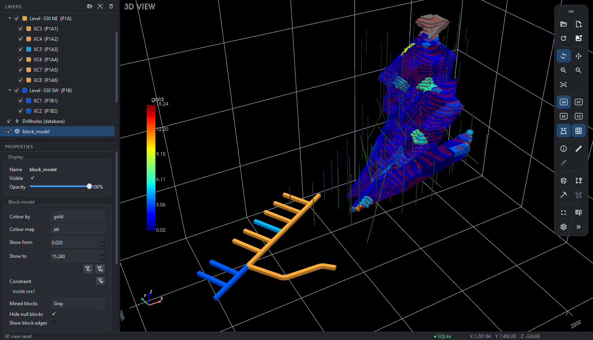

The stack is Python 3.10, PySide6 (Qt 6), VTK/PyVista and NumPy/pandas. It is packaged with PyInstaller into a self-contained `GeoViewer.exe`, and everything installs and builds **offline** from the bundled wheels.

---

## Contents

- [Functionality](#functionality)
  - [Main window](#main-window)
  - [Supported data](#supported-data)
  - [Workspaces and refresh](#workspaces-and-refresh)
  - [3D and 2D views](#3d-and-2d-views)
  - [Block models and constraints](#block-models-and-constraints)
  - [Identify and measure](#identify-and-measure)
  - [Cross-sections](#cross-sections)
  - [Drillholes: log window and Drillhole Manager](#drillholes-log-window-and-drillhole-manager)
  - [Underground survey (pits and drives)](#underground-survey-pits-and-drives)
  - [Pit export: SHP, 3D DTM, PNG](#pit-export-shp-3D-dtm-png)
  - [Reserve and mined shapes](#reserve-and-mined-shapes)
  - [Map export](#map-export)
  - [Settings and the project database](#settings-and-the-project-database)
  - [Keyboard shortcuts](#keyboard-shortcuts)
- [Setup Environment](#setup-environment)
- [How to Test](#how-to-test)
- [Build & Release](#build--release)
- [Project layout](#project-layout)

---

## Functionality

### Main window

The window opens maximized, in a dark theme, with no menu bar:

- **Layers** (top left): every open layer, in drawing order. Each one has a visibility checkbox, a context menu (zoom to, rename, remove) and drag-to-reorder. Survey pits are listed as a tree of main pits and their branches.
- **Properties** (bottom left): settings for the selected layer, such as colour, opacity, colour-by attribute, colour map, value range, constraints, edges and labels. Below them is an **Information** block with the extents, object and triangle counts, and the style file.
- **View** (right): the 3D or 2D scene. The caption at the top left ("3D VIEW", "XY PLANE" …) shows the current view.
- **Floating toolbar** (right edge): drag it anywhere, or hide it with an animation. Bring it back with **Ctrl+T** or the round floating button.
- **Status bar**: messages, the database state (SQLite / MySQL) and the XYZ coordinates under the cursor.

The toolbar groups, top to bottom:

1. **Files**: open workspace, open files, refresh (F5), export map.
2. **Navigation**: rotate, pan, zoom in, zoom out, home.
3. **Views**: 3D, plan XY, section XZ, section YZ, perspective/orthographic, map grid.
4. **Tools**: identify, measure, cross-section.
5. **Data**: Drillhole Manager, Survey, Reserve, mined outline.
6. **Window**: full screen, settings, hide toolbar.

### Supported data

| Data | Files | Notes |
|---|---|---|
| 3D strings | `.str` | Records are `string, Y, X, Z, D1…`. Styles come from the `.ssi` file named in the header. |
| 3D DTM surfaces and solids | `.dtm` (with its `.str`) | Each trisolation becomes an object. Solids are recognised from their geometry (watertight), not from the `closed` flag. |
| Block models | `.csv` (3D block export) | Columns X, Y, Z, block sizes and any attributes. Only the **exposed faces** are drawn, never buried or shared faces, so models of 10–40 million blocks stay responsive. Parsed models are cached in `%LOCALAPPDATA%\GeoViewer\cache`. |
| Drillholes | project database, 3D `.accdb` / `.mdb` / `.ddb`, or collar + survey + interval CSVs | Desurveyed with the minimum-curvature method. Holes are drawn as tubes (per-layer diameter) coloured by lithology. The `.accdb` is read directly, so no ODBC driver is needed. |
| DXF | `.dxf` | Includes old R10 files. |
| Underground survey | project database | Drawn from the survey records (see [Underground survey](#underground-survey-pits-and-drives)). |
| Mined shapes | project database | Drawn from the production records (see [Reserve](#reserve-and-mined-shapes)). |

To open files, use **Open files** (Ctrl+O), drag and drop files or folders onto the window, or pass them on the command line.

### Workspaces and refresh

A **workspace** is a folder of data files plus a `geoviewer_workspace.json` file. The JSON stores the layers, their order and display settings, per-pit styles, and the camera.

- The JSON is saved when the app closes, when another workspace is opened, or on **Ctrl+S** / **Save workspace as** (Ctrl+Shift+S).
- Paths inside the folder are stored relative to it, so a workspace can be moved or copied.
- At start-up GeoViewer reopens the last workspace. You can turn this off in Settings, or open a workspace directly with `GeoViewer.exe -w <folder>`.
- **Refresh (F5)** reloads only the layers whose files changed and adds new files found in the folder. **Auto refresh** does the same on a timer; set the interval in Settings → General.
- A layer whose file has gone missing stays in the workspace, and Refresh retries it.

### 3D and 2D views

- **3D** (Ctrl+1) has rotate and pan navigation. Perspective and orthographic projection toggle with Ctrl+5. **Home** returns to the default south-west view and fits everything visible.
- **Plan XY** (Ctrl+2), **section XZ** (Ctrl+3) and **section YZ** (Ctrl+4) are always orthographic and pan-only.
- **Map grid** (Ctrl+G) shows labelled coordinates in every view.
- **Full screen** (F11) covers the view. **Esc** leaves full screen, after first closing any open Identify result and then stopping the active tool.
- **Background colour** is set in Settings → Display. Overlay text switches between light and dark to stay readable on it.

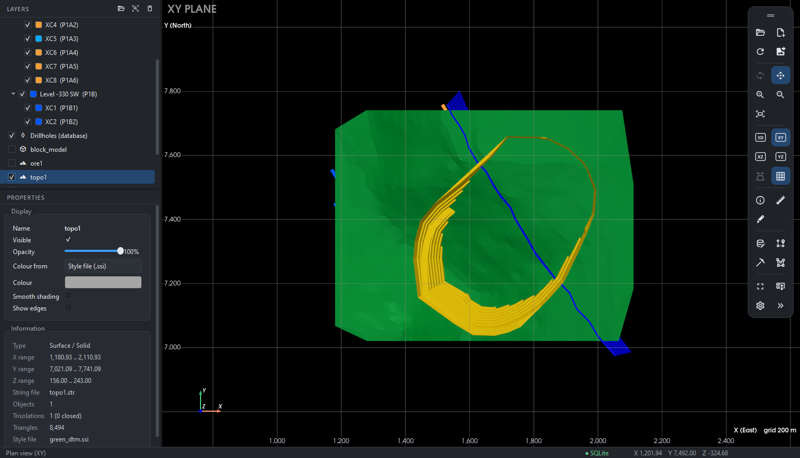

### Block models and constraints

- **Colour by** any numeric or text attribute, with a choice of colour map and value range. The legend shows only while the block model layer is selected.
- **Mined blocks** (blocks whose `mined_fraction` is at least 0.5, from the [Reserve](#reserve-and-mined-shapes)) can be shown as normal, grey, transparent or hidden.
- **Constraints** show only the blocks that meet a set of conditions, each tested at the block centre:
  - **DTM conditions**: inside or outside a solid, above or below a surface.
  - **Block value conditions**: `> ≥ < ≤ = ≠`, or `=` / `≠` a code for text attributes.

  Combine the conditions with *all* (and), *any* (or), or a custom expression such as `a and (b or not c)`. The expression is parsed by the app itself, never passed to `eval`. The dialog shows a live count of blocks kept.

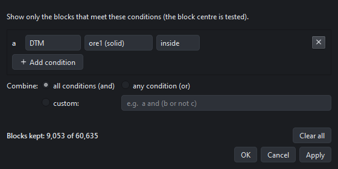

### Identify and measure

- **Identify** (Ctrl+I): click a feature to see its information.
  - A DTM object shows its area, volume (for solids) and extent.
  - A block shows all its attributes.
  - A drillhole interval opens the [drillhole log window](#drillholes-log-window-and-drillhole-manager).
- **Measure** (Ctrl+M): click two points to get the distance, bearing and inclination.

### Cross-sections

The cross-section tool (Ctrl+K) works in the 2D views:

1. Click points to build a polyline.
2. Right-click or press Enter to open the **points editor**. There you can type or adjust coordinates and add or remove points. Duplicate nodes closer than 0.05 m are removed.
3. Confirm, and the **section window** opens. It cuts every visible layer within a corridor of ±N m.

The section ends are labelled **A** and **A'**, and bends are numbered. The window has a grid, a scale bar and the block model legend. The section updates when layers change.

| Section line in plan | Section window |
|---|---|
| 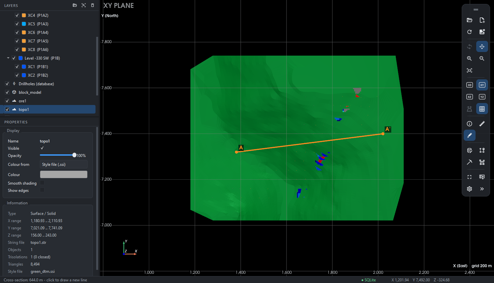 | 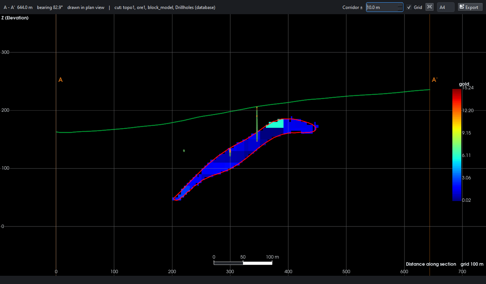 |

**Export** writes a single 300 dpi PNG page on white paper (A4/A3), sized to print at true scale. The plan with the section line is at the top and the section is at the bottom.
- The scale is rounded to a standard 1:N and shown in the title.
- Coordinates are labelled outside the frames.
- Legends sit in a column on the right.
- Each map has a two-tone scale bar.

<p align="center">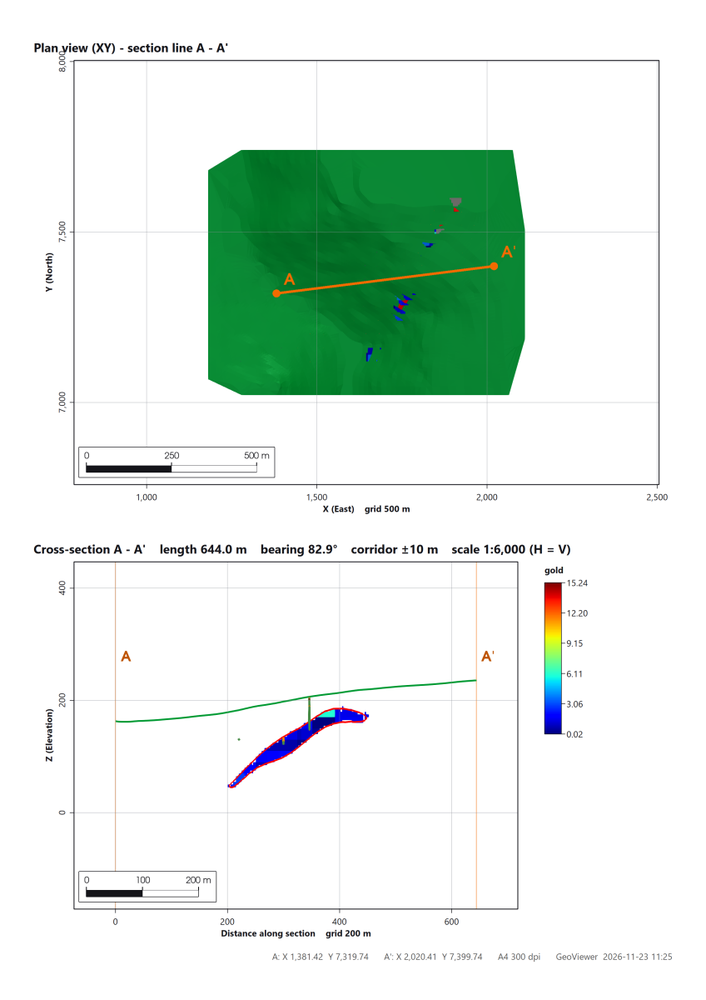</p>

### Drillholes: log window and Drillhole Manager

**Drillhole log window.** Identifying a drillhole opens its log:

- **Header**: the hole ID and length, the depth and interval under the marker, its XYZ, and the azimuth and dip at that depth. Dip is shown positive downward.
- **Left pane**: the strip log (lithology column plus assay graphs such as gold and silver).
  - The mouse wheel zooms, down to 0.5 m.
  - Dragging beside the column pans.
  - Double-clicking shows the whole hole.
- **Right panes**: an XZ section and an XY plan centred on the collar, at the same scale and each with a scale bar.
- **Depth marker**: clicking the strip log or the hole trace moves a yellow marker in all three panes. The marker appears on screen only, never in prints.
- **Output**: **Print…** (A4 landscape) and **Save image…** (300 dpi PNG) produce a white paper version.

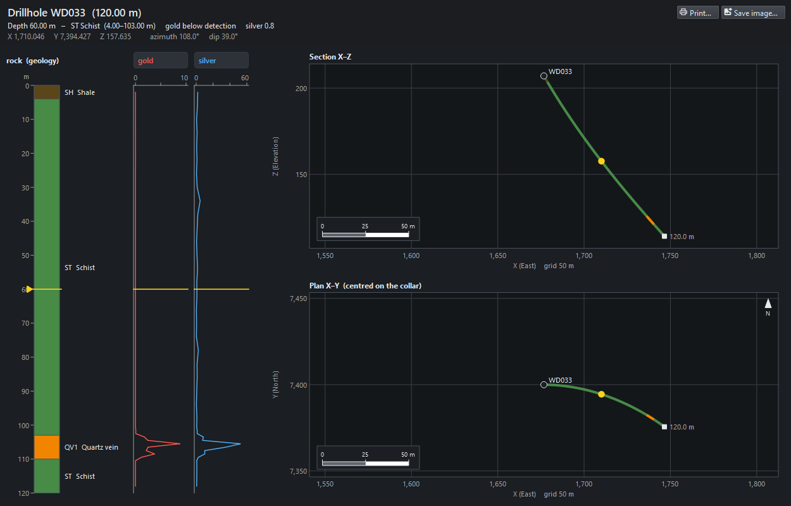

**Drillhole Manager** (Ctrl+D) edits the drillhole tables in the project database:

- Add and remove holes.
- Edit the collar, survey, geology and assay records. Collar fields include organization, drilling manager, geology surveyor, start and end dates, and state.
- Each hole is checked, then saved in a single transaction.
- Assay fields can be added, renamed or removed.
- The Rock cell picks from the **Rock colours** list, and those colours are used in the 3D view and in sections.
- **Export to Excel** writes the collar, geology, survey and assay sheets.

| Holes | Rock colours |
|---|---|
| 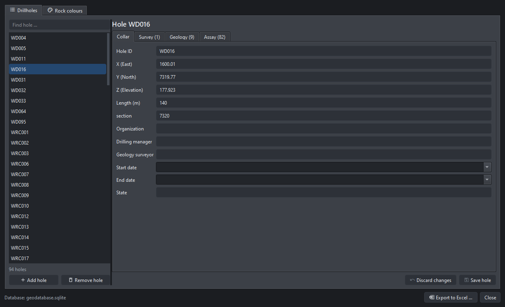 | 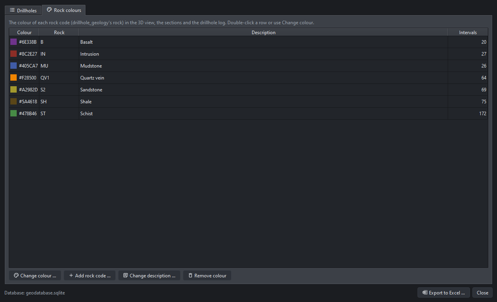 |

### Underground survey (pits and drives)

The **Survey** window (Ctrl+U) is for traversing underground workings where GPS is not available.

- **Pits**: each **main pit** starts at an entrance whose X, Y, Z are known. Pits have **branches** to any depth, for example P1 → P1A → P1A1. Several main pits can share one workspace.
- **Stations** are numbered automatically (`<code>-01`, `-02` …) and the names can be edited.
- **Survey methods**: each setup uses one of three methods:
  - **Total station**: a backsight station or a known bearing, then HA, ZA, SD, HI and HT, with optional face-right readings.
  - **Compass**: the bearing of the leg, magnetic, true or grid. Declination and convergence are set in **Survey settings**.
  - **Coordinates (X, Y, Z)**: type in the new station's coordinates when they were already calculated, for example by another program or an earlier survey.
    - This works for any station in any pit: a main pit's first station, a station in the middle of a traverse, or a branch's first or later stations.
    - The coordinates are used as they are, like a known station. They are never adjusted, and a later traverse can continue from them or close on them.
    - In the station list such stations have the status **given**.
- **Angle entry**: angles can be typed as `120 30 00` or `120.5` and are displayed as 120°30′00″.
- **Closure**: closing a traverse on a known station or back on the entrance reports its closure. A passing closure can be spread with the **Bowditch** method.
- **Profile**: each pit has a rectangular profile (width × height). You choose whether its stations are in the backs (roof), the floor or the middle.
- **Live plan map**: wheel to zoom, drag to pan, double-click to fit. It shows stations, legs and survey direction, and highlights the selected pit.

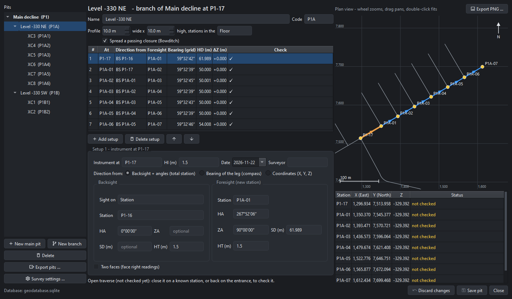

**In the 3D view**, the drives are swept along the surveyed centre lines with each pit's profile. The Layers panel lists the survey as a tree of pits, and each pit has these settings:

- visibility, which also hides its branches;
- colour, with an *inherit parent pit's colour* option;
- centre lines and station names, set on the main pit and applied to all its branches.

Where a branch meets its parent, the branch starts at the parent's wall and does not overlap inside the parent drive. Inclined drives keep their roof and floor wedges, so the walls meet without gaps.

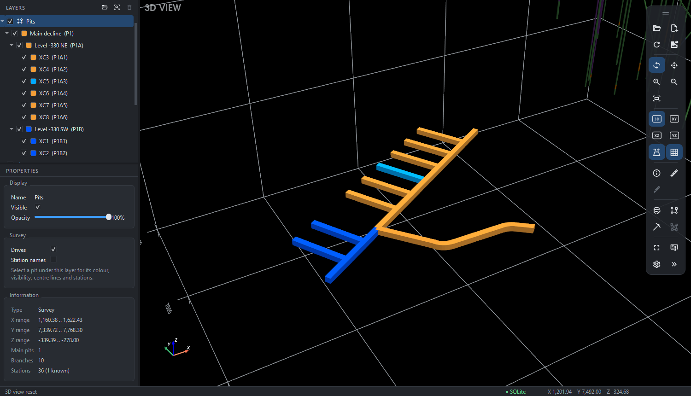

### Pit export: SHP, 3D DTM, PNG

The Survey window has two export buttons: **Export pits …** and **Export PNG …**.

**Export pits** asks two questions:
- **Scope**: *all pits*, or *the selected pit and its branches*.
- **Format**: one of the two below.

| Format | Contents |
|---|---|
| **Centre lines – ESRI shapefile** (`.shp`, `.shx`, `.dbf`, `.cpg`) | One 3D line (PolyLineZ) per pit. M holds the 3D chainage. The attribute table has PIT_ID, NAME, CODE, PARENT, MAIN_PIT, START_STN, WIDTH, HEIGHT, STN_LEVEL, LENGTH_2D and STATIONS. It is written without any GIS library. |
| **Drive solids – 3D DTM** (`.dtm` + `.str`) | Each pit is one object, and its drive is a closed, validated solid: neighbours are set and the winding is consistent. The profile is the same as in the 3D view, including branch junctions trimmed at the parent's wall. The files open directly in 3D. |

<p align="center">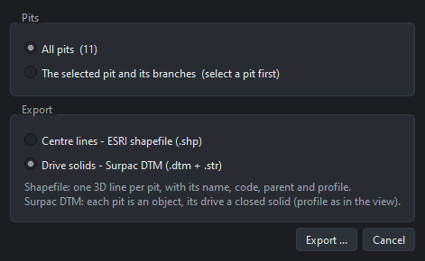</p>

**Export PNG** saves the survey plan as a 300 dpi print-ready image:
- white paper, with all pits in uniform grey and no screen highlight colours;
- every station marked and labelled, with labels placed to avoid overlaps and leader lines where space is tight;
- the coordinate grid, a north arrow and a scale bar.

<p align="center">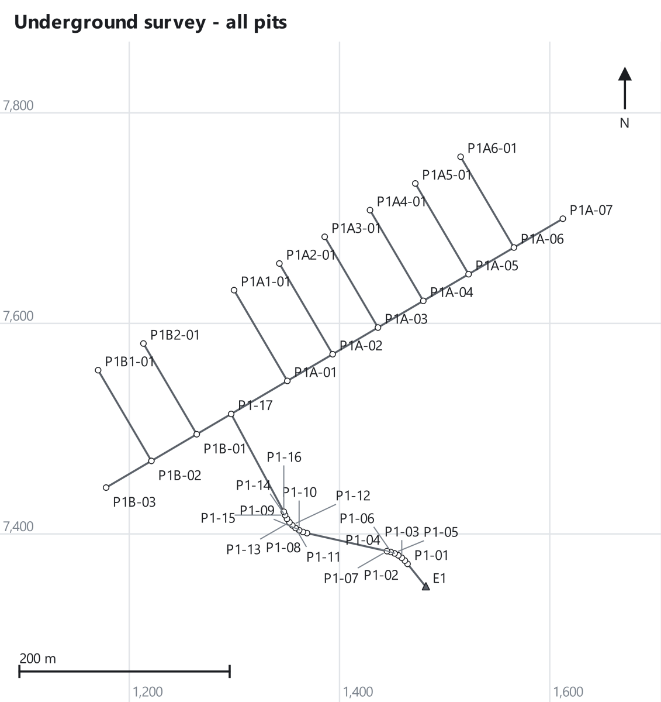</p>

### Reserve and mined shapes

The **Reserve** window (Ctrl+E) tracks production against the block model reserve, without survey equipment.

**Setup.** The reserve is set up automatically from the block model, an ore solid, the density and the grade attribute. You can change it under **Setup**.

**Recording mined shapes.** There are two ways:
- **Mined outline** (Ctrl+L): draw the mined area in a 2D view, then enter the date, name and the **From / To** depths along the view axis. A depth profile with draggable From/To handles helps you pick the depths.
- **Load mined solid …**: use a closed 3D `.dtm` that describes the mined void.

**Depletion.** Each reserve block is sampled at 8 points, and each point is mined by the earliest cut, so nothing is counted twice. The window shows:
- cards for **Total reserve**, **Produced** and **Remaining** (tonnes, grade and metal in kg, or t for % grades), as of any date;
- a table of mined shapes and a **By month** summary;
- **Export CSV**.

Records are kept in the project database. The block model file is never changed.

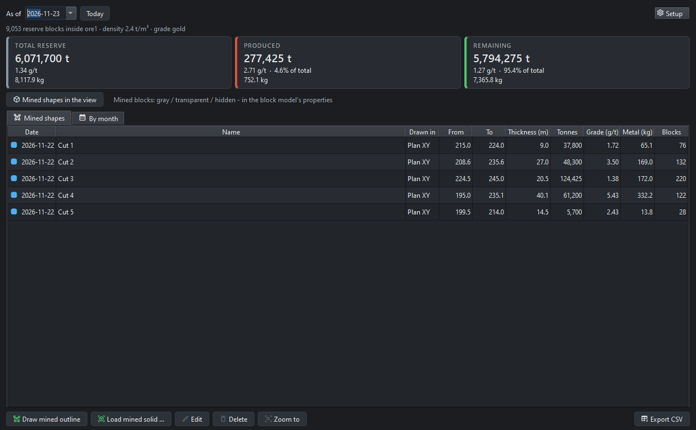

### Map export

**Export map** (Ctrl+Shift+P) turns the current view into a page saved as a 300 dpi PNG:
- A4 or A3, landscape or portrait, with a title.
- 2D views can be printed at a **true scale** (1:N) or fitted to the page. 3D views export as shown on screen.
- Optional grid lines with coordinates written outside the frame, and a legend beside the map (rock codes, pit colours, block model colour bar).
- A north arrow, a scale bar and a footer.

| Export window | Exported page |
|---|---|
| 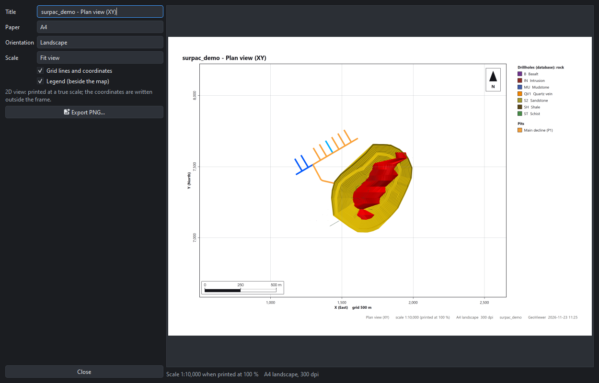 | 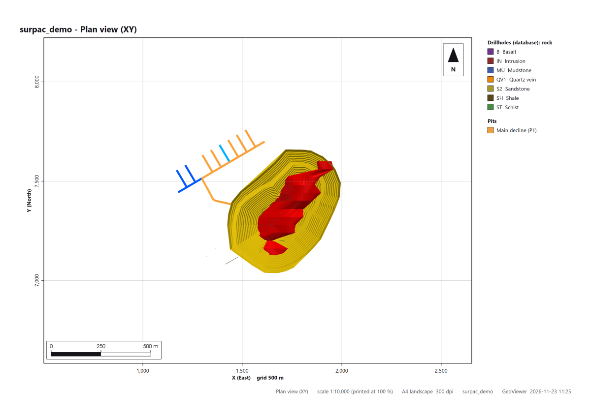 |

### Settings and the project database

**Settings** (Ctrl+,) has three pages:
- **General**: the interface language, start-up behaviour and auto refresh.
- **Display**: view caption, background colour and similar options.
- **Database**: chooses the project database and its connection. A **Create tables** button adds any missing tables or fields.

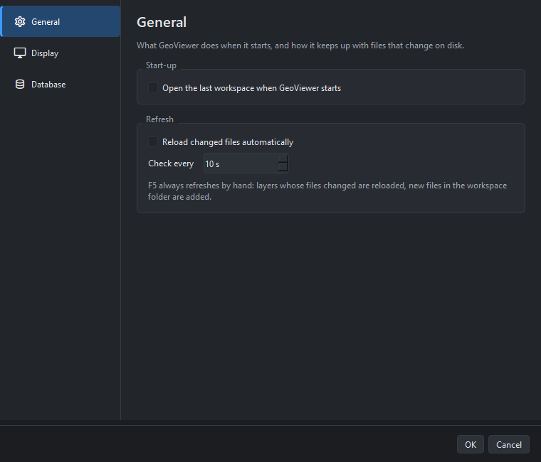

**Project database.** Everything except the workspace JSON lives in **one** project database, with table prefixes `drillhole_`, `survey_` and `prod_`. It is one of two backends:

- **SQLite** (`geodatabase.sqlite` in the workspace folder), which needs no server; or
- **MySQL 8** (host, port, database, user). The password is encrypted with Windows DPAPI in the user's settings.

Database initialisation only **adds**. It creates missing tables and fields and never drops tables, columns or rows. Changes made by other users are picked up through a `table_updates` table maintained by triggers.

### Languages

The interface is available in **English** and **Simplified Chinese (简体中文)**. That covers every window, message, tooltip, exported page, and the text drawn in the 3D view. Qt's own buttons and dialogs (OK, Cancel, file dialogs) are translated too.

- **Choosing**: Settings → General → **Language**. *Windows display language* (the default) picks Chinese on a Chinese Windows and English otherwise. The choice takes effect the next time GeoViewer starts.
- **What stays as typed**: station, hole, pit and layer names, attribute names, and the column names written to CSV, Excel and shapefiles.
- **Fonts**: text drawn by VTK (view caption, axis titles, scale bar, legends) uses Microsoft YaHei or SimHei when Chinese is active, because VTK's built-in font has Latin letters only.

**How it works** (`geoviewer/i18n/`):
- The English text in the code is the key: `tr("Open files")`. Placeholders are named, as in `tr("{n:,} holes", n=count)`.
- `trn("{n} hole", "{n} holes", n)` handles counts, and `trc("drillhole", "Survey")` handles a word with two meanings.
- Each other language is **one JSON file** in `geoviewer/i18n/locales/` (`zh_CN.json`). It holds the language's name, its Qt translation and its fonts, plus a `messages` map from English to translation. An empty or missing message falls back to English.

**Adding a language**, for example French:

```bat
.venv\Scripts\python.exe tools\i18n_extract.py --new fr --name Français --english-name French
:: fill in geoviewer\i18n\locales\fr.json (every message starts empty), then check it:
.venv\Scripts\python.exe tools\i18n_extract.py --check
```

The new file is found automatically and listed in Settings, and the release build packs it together with Qt's matching `qtbase_fr.qm`. After code changes, `tools\i18n_extract.py --update` adds new texts to every language file and drops unused ones. `--missing zh_CN` lists what still needs translating.

### Keyboard shortcuts

| Key | Action | Key | Action |
|---|---|---|---|
| Ctrl+O | Open files | Ctrl+I | Identify |
| Ctrl+Shift+O | Open workspace | Ctrl+M | Measure |
| Ctrl+S / Ctrl+Shift+S | Save workspace / as | Ctrl+K | Cross-section (2D) |
| F5 | Refresh | Ctrl+L | Mined outline (2D) |
| Ctrl+1 … Ctrl+4 | 3D / XY / XZ / YZ | Ctrl+E | Reserve |
| Ctrl+5 | Perspective / orthographic | Ctrl+D | Drillhole Manager |
| Ctrl+G | Map grid | Ctrl+U | Survey |
| Ctrl+R / Ctrl+P | Rotate / pan mode | Ctrl+Shift+P | Export map |
| Ctrl+= / Ctrl+- | Zoom in / out | Ctrl+, | Settings |
| Home | Home view | Ctrl+T | Show / hide toolbar |
| F11 | Full screen | Esc | Close result → stop tool → leave full screen |

---

## Setup Environment

**Requirements:** Windows 10/11 x64 and an OpenGL 3.2+ capable GPU. Internet access is **not** needed.

The repository ships everything for an offline install:

| Path | Contents |
|---|---|
| `whl\` | All Python wheels at the exact versions in `requirements-offline.txt` |
| `whl\runtime\` | `python-3.10.11-amd64.exe` and `vc_redist.x64.exe` |
| `requirements-offline.txt` | The complete, pinned dependency lock (installed with `--no-deps`) |
| `requirements.txt` | Direct dependencies, with a note on what each is for |

### One-step install

```bat
install_env.bat            :: install or repair
install_env.bat /clean     :: delete .venv first, then install
install_env.bat /test      :: only run the checks
```

`install_env.bat` does the following:

1. **Finds Python 3.10.** If there is none, it installs `whl\runtime\python-3.10.11-amd64.exe` for the current user.
2. **Installs the VC++ 2015–2022 runtime** if `msvcp140_1.dll` is missing. This step needs admin rights.
3. **Creates `.venv`** and installs the packages offline from `whl\`.
4. **Runs the checks**: `tools\pip_check.py`, `tools\smoke_test.py` (imports, off-screen OpenGL, Qt, demo data load) and the unit tests.

### Run from source

```bat
run_geoviewer.bat                                  :: reopens the last workspace
run_geoviewer.bat -w 3D_demo                   :: opens a workspace folder
run_geoviewer.bat 3D_demo\topo1.dtm 3D_demo\pit1.str
```

Or activate the venv and run the package:

```bat
.venv\Scripts\activate.bat
python -m geoviewer -w 3D_demo
```

**Demo data:** `3D_demo\` holds a complete example workspace:
- topography, pit, fault and ore DTMs;
- a block model CSV;
- the project database `geodatabase.sqlite`, with drillholes and an 11-pit underground survey;
- the workspace JSON.

**Database:** the default backend is MySQL. To work without a server, choose **SQLite** in Settings → Database.

**Logs:** runtime errors, plus stack dumps if the GUI stops responding for 15 s, are written to `%LOCALAPPDATA%\GeoViewer\logs\geoviewer.log`.

### Adding a dependency

1. Download the wheel for **cp310 / win_amd64** into `whl\`. A package published only as source needs a wheel built with `pip wheel`, as was done for `access_parser`.
2. Add the exact version to `requirements-offline.txt` and the package name to `requirements.txt`.
3. Run `install_env.bat`.

Use `PySide6_Essentials` only. The full `PySide6` meta-package pulls in WebEngine and the add-ons, several hundred MB.

---

## How to Test

The tests use **pytest** and live in `tests\`. There are 286 tests.

```bat
:: everything (what install_env.bat runs)
.venv\Scripts\python.exe -m pytest -q -p no:cacheprovider tests

:: one area
.venv\Scripts\python.exe -m pytest -q tests\test_pit_export.py tests\test_survey.py

:: one test, verbose
.venv\Scripts\python.exe -m pytest -q tests\test_section.py -k scale -vv

:: environment checks only (packages, OpenGL, Qt, demo data)
install_env.bat /test
.venv\Scripts\python.exe tools\smoke_test.py
```

| Area | Test files |
|---|---|
| 3D readers (STR, DTM, SSI), DXF | `test_3D_str_dtm.py`, `test_ssi.py`, `test_scene_utils.py` |
| Block models, exposed faces, constraints | `test_block_model.py`, `test_block_faces.py` |
| Drillholes (desurvey, log window, database, manager) | `test_drillholes.py`, `test_drillhole_store.py` |
| Views, navigation, grid, identify, measure | `test_navigation.py`, `test_map_grid.py`, `test_identify.py`, `test_measure.py` |
| Cross-sections and map export | `test_section.py`, `test_map_export.py` |
| Underground survey and pit export | `test_survey.py`, `test_survey_display.py`, `test_survey_manager.py`, `test_pit_export.py` |
| Reserve and production | `test_production.py` |
| Workspaces | `test_workspace.py` |
| Languages (catalog complete, placeholders, Qt translation, VTK font, windows in Chinese) | `test_i18n.py` |
| MySQL backend | `test_mysql.py` (see below) |

How the tests are isolated (fixtures in `tests\conftest.py`):

- **Database**: every test starts on SQLite with no workspace folder.
- **Cache**: block model caches go to a pytest temporary folder, **never** to the user's `%LOCALAPPDATA%\GeoViewer\cache`. Any new test or script must keep it that way.
- **GUI tests** run the real Qt widgets and off-screen VTK renders. No window needs to stay focused, but a working OpenGL driver is required.
- **Demo data**: tests that need `3D_demo\` copy it to a temporary folder first, and are skipped if it is missing. The Access database fixture is `tests\data\3D.accdb`.

**MySQL tests** are skipped unless a test server is given. Use a scratch database, because the tests create and drop tables in it:

```bat
set GEOVIEWER_TEST_MYSQL=localhost:3306:<user>:<password>:geoviewer_test
.venv\Scripts\python.exe -m pytest -q tests\test_mysql.py
```

---

## Build & Release

The release is built offline with PyInstaller from `packaging\geoviewer.spec`.

```bat
build_release.bat                 :: build, smoke-test the exe, zip
build_release.bat --skip-build    :: re-test and re-zip an existing build
build_release.bat --no-test       :: skip the smoke test of GeoViewer.exe
build_release.bat --no-zip        :: do not create the zip
build_release.bat --keep-work     :: keep distribute\build
build_release.bat --with-demo     :: include 3D_demo\ as sample data
```

`build_release.bat` installs PyInstaller from `whl\` if it is missing, then runs `packaging\build_release.py`. The steps are:

1. Run PyInstaller with `packaging\geoviewer.spec`. The entry point is `packaging\geoviewer_entry.py` and the icon is `packaging\geoviewer.ico`.
2. Write `README.txt` and `THIRD_PARTY_NOTICES.txt` into the application folder. Build-only packages such as PyInstaller and pytest are left out of the notices.
3. Smoke-test the built exe: `GeoViewer.exe --smoke-test` with the demo files.
4. Zip the folder.

| Output | Contents |
|---|---|
| `distribute\dist\GeoViewer\` | The application: `GeoViewer.exe` plus its libraries. It runs without Python installed. |
| `distribute\release\GeoViewer_<version>_win64.zip` | The zip to hand out |
| `distribute\build\` | PyInstaller work folder, deleted unless `--keep-work` |

**Version:** set `__version__` in `geoviewer\__init__.py` (and `version` in `pyproject.toml`). The zip name and the release README take the version from there.

**Size:** about 576 MB unpacked, 188 MB zipped. `vtk.libs` alone is about 244 MB.

**Debug build:** the exe is windowed, so tracebacks are hidden. For a build with a console window:

```bat
set GEOVIEWER_CONSOLE=1
build_release.bat
```

**Known build notes:**
- During the build, warnings like `EndUpdateResourceW … used by another process` come from antivirus scanning. PyInstaller retries and succeeds.
- Do not exclude `pyvista.jupyter` in the spec. PyVista imports it at start-up, and the exe dies at launch without it.

**Deploying:** unzip `GeoViewer_<version>_win64.zip` anywhere and run `GeoViewer.exe`. If the target PC lacks it, install the VC++ runtime from `whl\runtime\vc_redist.x64.exe`. Each user's settings are stored in the Windows registry (QSettings). Caches and logs go under `%LOCALAPPDATA%\GeoViewer\`.

---

## Project layout

```
geoviewer/
  app.py              entry point: arguments, theme, main window, freeze watchdog
  workspace.py        workspace JSON (layers, view, per-pit styles)
  i18n/               translations: tr() / trn() / trc(), locales/<code>.json (zh_CN.json)
  project_db.py       project database initialisation (add-only)
  io/                 readers and stores: 3D STR/DTM/SSI, block model CSV + cache, DXF,
                      drillholes (.accdb/CSV/database), survey_store, pit_export (SHP/DTM),
                      database (SQLite/MySQL)
  scene/              VTK scene and layers: block faces, constraints, sections, survey drives,
                      production/depletion, reserve, map grid, picking
  ui/                 Qt windows: main window, floating toolbar, layer tree, properties,
                      section tool/view/print, drillhole log/manager, survey manager,
                      reserve, map export, settings
packaging/            PyInstaller spec, entry script, icon, build_release.py
tools/                pip_check.py, smoke_test.py, i18n_extract.py (language files)
tests/                pytest suite (+ tests/data)
3D_demo/          demo workspace and data
whl/                  offline wheels (+ runtime/ installers)
docs/images/          README screenshots
```
